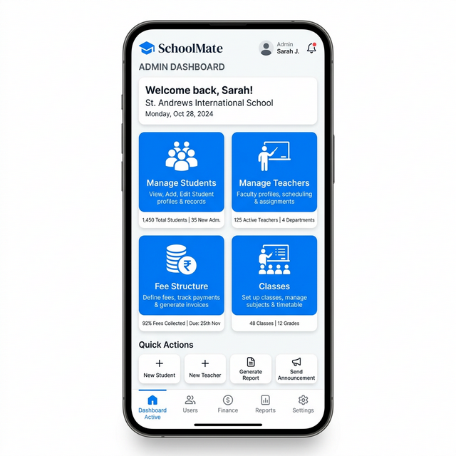
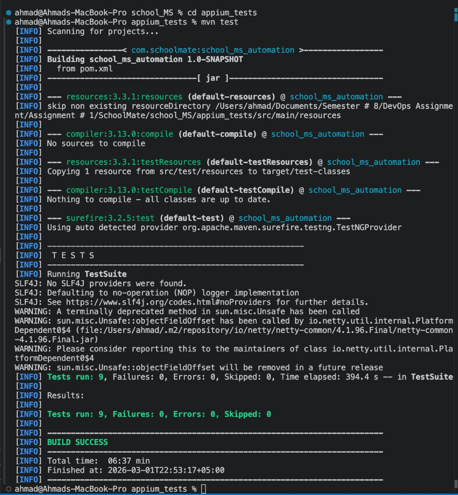

# SchoolMate - School Management System

## 🌟 1. Project Overview
**SchoolMate** is a mobile-first School Management System (SMS) built using the **Flutter** framework. It is designed to digitize school operations by providing three distinct user roles:

- **Admin**: Manages school infrastructure (classes, subjects, fees) and oversees teachers/students.
- **Teacher**: Handles attendance, assignments, and exam results.
- **Student**: Tracks academic progress, timetables, and notices.

The project uses a **Local File Persistence** system, making it lightweight and highly portable.

## 🧪 2. Purpose of Appium
We use **Appium** for Automated Mobile Testing. Instead of manually checking every feature after a code change, we use Java scripts to:
- Automatically control an Android emulator.
- Verify critical workflows (Login, Signup, User Management).
- Ensure that new updates don't break existing functionality (Regression Testing).

## 🛠️ 3. Tools & Technologies Used
| Category | Technology | Purpose |
| :--- | :--- | :--- |
| **Mobile App** | Flutter (Dart) | Cross-platform UI development. |
| **Automation Language**| Java 17 | Logic for test cases. |
| **Build Tool** | Maven | Managing Java dependencies. |
| **Testing Framework** | TestNG | Test organization and assertions. |
| **Automation Driver** | Appium | Bridge between code and Android OS. |
| **CI/CD** | GitHub Actions | Automated build and test pipeline. |

## 📂 4. Project Structure
```text
school_MS/
├── lib/                        # Flutter Application Source
│   ├── models/                 # Data Models (User, Class, etc.)
│   ├── screens/                # UI Layer (Admin, Teacher, Student modules)
│   ├── services/               # Business Logic & File Persistence
│   └── main.dart               # App Entry Point
├── appium_tests/               # Automation Framework
│   ├── src/test/java/          # Test Scripts & Page Objects
│   ├── src/test/resources/     # TestNG Configurations
│   └── pom.xml                 # Maven Project Config
├── .github/workflows/          # CI/CD Pipeline (GitHub Actions)
└── build/app/outputs/flutter-apk/ # Generated App Binaries
```

## 📸 5. Screenshots

*Professional Mockup for the Admin Dashboard*


*Verified Automation: 9 Test Cases passing successfully in 6 minutes*

## 🚀 6. Getting Started (End-to-End Guide)

### Step A: Cloning the Project
```bash
git clone https://github.com/AhmadR-11/SchoolMate.git
cd SchoolMate/school_MS
```

### Step B: Setting up the App
1. Install dependencies: `flutter pub get`
2. Build the app file (APK):
   ```bash
   flutter build apk --debug
   ```

### Step C: Running Automated Tests Locally
1. **Start Appium**: Run `appium` in your terminal.
2. **Navigate to Tests**: `cd appium_tests`
3. **Execute**:
   ```bash
   mvn test
   ```

## ⚙️ 7. Continuous Integration (CI)
We use **GitHub Actions** to automate our testing on every push.
- **Workflow**: Builds APK -> Starts Emulator -> Runs Appium Tests.
- **Runner**: macOS logic for high-performance Android emulation.

## 🌿 8. Git Workflow Strategy
- **`application` branch**: Stable, production-ready code.
- **`test` branch**: Feature branch for automation and CI updates.

---
**Developed by:** AhmadR-11  
**Project:** DevOps Assignment #1 - School Management System
